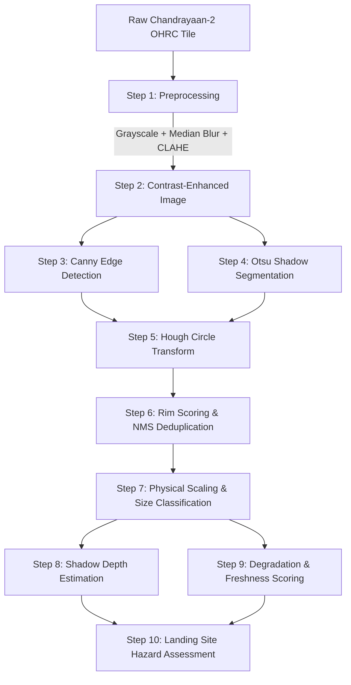

# Lunar Crater Detection System: Classical Computer Vision Analysis
### Planetary Surface Characterization using Chandrayaan-2 OHRC Imagery

---

## 1. Project Overview

The **Lunar Crater Detection System** is an end-to-end computer vision and planetary science pipeline designed for high-resolution lunar surface analysis. Built using classical image processing techniques (**OpenCV**, **NumPy**, **Matplotlib**) and deployed via an interactive **Streamlit** dashboard, the system processes optical surface tiles from the **Orbiter High Resolution Camera (OHRC)** aboard the **Chandrayaan-2** mission.

Rather than relying on black-box deep learning models, this project utilizes deterministic, physics-grounded computer vision to achieve two primary objectives:
1. **Detection & Geometric Extraction**: Identify crater boundaries, compute real physical dimensions (diameter in meters), and categorize impact sizes.
2. **Geophysical Characterization**: Calculate crater excavation depths via shadow trigonometry, score crater degradation/freshness, and evaluate landing-site hazard risks for Artemis/Chandrayaan-class lunar landers.

---

## 2. End-to-End Processing Pipeline

The system processes raw orbital imagery through an 8-stage classical computer vision pipeline:



### Stage 1: Preprocessing (Denoising & Lighting Equalization)
* **Grayscale Conversion**: Eliminates redundant color channels to focus purely on surface reflectance (albedo) and cast shadows.
* **Median Blur Filter ($5 \times 5$)**: Removes high-frequency salt-and-pepper regolith noise and sensor speckles while preserving sharp rim boundaries.
* **CLAHE (Contrast-Limited Adaptive Histogram Equalization)**: Overcomes extreme lunar lighting (high-contrast sunlight and pitch-black cast shadows) by equalizing contrast locally across $8 \times 8$ grid tiles without amplifying noise.

### Stage 2: Rim Edge Detection
* **Percentile-Adaptive Canny Detection**: Computes gradient intensity using Sobel kernels. Upper and lower thresholds adapt dynamically based on local image median intensity ($0.55 \times \text{median}$ to $1.45 \times \text{median}$), reliably isolating circular crater rims.

### Stage 3: Interior Basin Segmentation
* **Otsu Thresholding**: Automatically determines an optimal global threshold to separate shadowed crater floors from sunlit surface regolith.
* **Morphological Opening & Closing**: Uses an elliptical structuring element ($3 \times 3$) to eliminate isolated single-pixel shadow artifacts and close boundary gaps inside crater cavities.

### Stage 4: Circular Fitting (Hough Circle Transform)
* Applies Gaussian pre-smoothing ($\sigma = 1.5$) to suppress false edge tangents.
* Runs the **Hough Gradient Transform** to identify candidate circle centers and radius estimates $(x, y, r)$ across the parameter accumulator space.

### Stage 5: Rim Edge Scoring & Non-Maximum Suppression (NMS)
* **Edge Density Verification**: Evaluates each candidate circle by measuring edge density along an annular ring around its perimeter ($r \pm 2\text{ px}$). Weak false-positive circles are penalized.
* **Non-Maximum Suppression (NMS)**: Eliminates concentric or duplicate bounding boxes by measuring spatial overlap ($IoU$) and center-to-center distance ($d < (r_1 + r_2) \times 0.65$), ensuring only the cleanest, most distinct detections are retained.

### Stage 6: Physical Metric Scaling & Size Classification
Converts pixel measurements to real-world meters using the native sensor resolution ($0.25\text{ m/pixel}$ for Chandrayaan-2 OHRC):
$$\text{Diameter (m)} = 2 \times r_{\text{px}} \times \text{Resolution}$$
* **Small Craters**: $< 10\text{ m}$ (micro-impacts, secondary craters)
* **Medium Craters**: $10\text{ m} - 30\text{ m}$ (simple bowl-shaped craters)
* **Large Craters**: $> 30\text{ m}$ (major structural impact craters)

### Stage 7: Shadow Trigonometry Depth Estimation
Leverages solar illumination geometry to compute excavation depth from horizontal shadow length:
$$\text{Depth (m)} = \text{Shadow Length (m)} \times \tan(\theta_{\text{sun}})$$
* Samples intensity profiles across the crater diameter along the illumination vector.
* Measures shadow boundary transition points to calculate the depth-to-diameter ($d/D$) ratio, a key metric for crater morphology (expected simple crater $d/D \approx 0.10 - 0.20$).

### Stage 8: Morphological Degradation & Freshness Scoring
Classifies each crater into one of four evolutionary degradation stages:
1. **Rim Sharpness Score**: Quantifies the continuity of Canny edges along the rim perimeter.
2. **Floor Smoothness Score**: Measures standard deviation of interior pixel intensities.
3. **Degradation Class (1 to 4)**:
   * **Class 1 (Fresh)**: Crisp, razor-sharp rim; deep shadow; fresh impact ejecta.
   * **Class 2 (Slightly Degraded)**: Mildly eroded rim; minor micro-bombardment infill.
   * **Class 3 (Moderately Degraded)**: Subdued rim crest; flattened interior floor.
   * **Class 4 (Heavily Degraded)**: Highly smoothed rim; ancient, extensively infilled basin.

### Stage 9: Landing Site Hazard Assessment
* Generates a spatial risk grid across the tile ($32 \times 32\text{ px}$ cells).
* Computes local hazard weights factoring in crater density, diameter, and rim freshness (fresh craters pose severe boulder/ejecta hazards).
* Yields a tripartite landing suitability map:
  * 🟢 **Green (Safe Zone)**: Smooth, low-relief regolith; ideal for landing gear touch-down.
  * 🟡 **Yellow (Caution Zone)**: Moderate crater density; requires terrain hazard avoidance.
  * 🔴 **Red (Hazard Zone)**: Steep crater walls, deep shadows, or rocky impact rims.

---

## 3. Comprehensive Feature List

### A. Visualization & Annotation Features
* **Purple Bounding Boxes (Dataset Reference Format)**: Annotates detected craters using clean purple rectangles (`#9333EA` / `BGR: (220, 80, 160)`), directly matching standard YOLO/benchmark planetary datasets.
* **Multiple Display Modes**: Switch between **Purple Bounding Boxes**, **Fitted Circles**, or **Combined (Boxes + Circles)**.
* **Interactive Crater Annotations**: Persistent crater IDs with hover details for diameter, size class, degradation, freshness, and location. Moon detections use purple; Mars detections use bright yellow with a dark outline.
* **Ground Truth Overlay**: Toggle manual dataset labels (rendered in cyan) to visually validate computer vision detections against benchmark truth.
* **Ground Truth Size Filter**: Slider to filter out minute ground truth labels ($< 11\text{ px}$) to prevent label clutter.

### B. Interactive Parameter Tuning (100% Real-Time Responsive)
* **Lunar Tile Selector**: Instant loading and processing of any of the 16+ Chandrayaan-2 OHRC tiles.
* **Spatial Resolution ($m/\text{px}$)**: Live adjustment of camera ground sampling distance (default `0.25 m/px`). Automatically recalculates all physical sizes, depths, areas, and densities.
* **Sun Elevation Angle ($^\circ$)**: Live angle adjustment ($10^\circ - 75^\circ$) that dynamically recomputes shadow excavation depths.
* **Min Crater Radius ($px$)**: Eliminates tiny noise speckles and clusters by setting a hard minimum detection boundary.
* **Max Detections Limit**: Controls candidate density, prioritizing prominent structural craters.
* **Detection Sensitivity (`param2`)**: Fine-tunes Hough accumulator threshold.
* **Min Distance Between Craters**: Adjusts spatial separation to prevent overlapping detections.
* **CLAHE Contrast Limit**: Controls local lighting equalization contrast.

### C. Analysis Tabs & Outputs
* **Annotated Detection Tab**: Full-resolution annotated tile with a dedicated "Surface Quantities" inspection sidebar (tile dimensions, physical area in $\text{km}^2$, crater density per $\text{km}^2$, rim freshness counts).
* **Pipeline Stages Tab**: Visual walkthrough displaying the intermediate output of every algorithmic step (Raw $\rightarrow$ CLAHE $\rightarrow$ Canny Rims $\rightarrow$ Otsu Shadows $\rightarrow$ Candidate Fits).
* **Depth & Landing Hazard Tab**:
  * Side-by-side **Shadow Depth Map** (gradient color-coded from shallow blue to deep red).
  * **Landing Site Suitability Map** (green/yellow/red risk overlay).
* **Size & Degradation Statistics Tab**:
  * Size-Frequency Distribution (SFD) histogram.
  * Small/Medium/Large crater category breakdown pie chart.
  * 4-class degradation breakdown bar chart.
* **Crater Catalog Tab**:
  * Tabulated DataFrame listing every detected crater with ID, coordinates $(X, Y)$, pixel radius, physical diameter ($m$), estimated depth ($m$), $d/D$ ratio, and freshness class.
  * **Download CSV Button**: One-click export of the crater catalog for scientific reporting.
* **Batch Analysis (All Tiles) Tab**:
  * Executes the pipeline across all 16+ Chandrayaan-2 tiles in a single batch.
  * Compiles multi-tile comparative statistics and cumulative Size-Frequency Distribution curves.

---

## 4. Technology Stack

| Component | Technology | Purpose |
| :--- | :--- | :--- |
| **Language** | Python 3.12 | Core programming environment |
| **Image Processing** | OpenCV (`cv2`) | Filtering, Canny edges, morphology, Hough transforms, drawing |
| **Numerical Math** | NumPy | Array arithmetic, statistics, mask operations, percentile cuts |
| **Visualization** | Matplotlib | Publication-quality histograms, pie charts, and bar plots |
| **Data Handling** | Pandas | Tabular data manipulation and CSV catalog generation |
| **User Interface** | Streamlit | Responsive, dark-themed web dashboard with live widget reactivity |

---

## 5. How to Run the System

### Prerequisites
* Python 3.10+ (Python 3.12 recommended)
* Virtual environment (`venv`)

### Installation & Execution
```bash
# 1. Clone or navigate to the project directory
cd /path/to/LunarCrateDetection

# 2. Activate the virtual environment
source venv/bin/activate

# 3. Install required packages (if not already installed)
pip install -r requirements.txt

# 4. Launch the Streamlit dashboard
streamlit run app.py
```
Open your browser to `http://localhost:8501` to access the application.

---

## 6. Scientific Significance & Applications

1. **Surface Dating via Crater Chronology**: Crater density per unit area ($\text{craters}/\text{km}^2$) serves as the primary clock for planetary surfaces. Higher cumulative counts correspond to older terrain dating back to the Late Heavy Bombardment.
2. **Landing Site Hazard Mitigation**: Identifying young, sharp-rimmed craters is critical for hazard avoidance systems (HDA), as they are surrounded by unstable ejecta blankets and hazardous boulders.
3. **Morphological Evolution**: Measuring $d/D$ ratios reveals the infilling rate and regolith turnover (gardening) driven by micrometeorite impacts over geological timescales.
